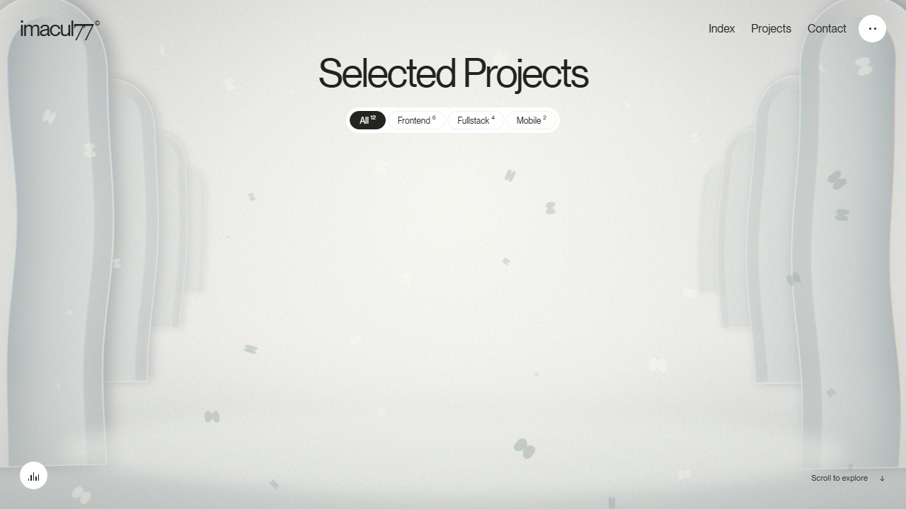

# IMACUL77 - Selected Projects

[](https://imacul77.vercel.app)

An immersive portfolio for **Emmanuel Oshakpemeh (IMACUL77)**, focused on frontend craft, fullstack systems, mobile products, and motion-led digital experiences.



## Highlights

- Liquid, architectural WebGL scene with a curved two-sided project gallery.
- Responsive project browsing with Frontend, Fullstack, and Mobile filters.
- Ambient sound with an explicit silent mode and reduced-motion fallback.
- Accessible image-grid fallback when WebGL is unavailable.
- Editable project and interface content stored in `content/site.json`.

## Run locally

```bash
python -m http.server 4173 --bind 127.0.0.1
```

Open <http://127.0.0.1:4173/>.

## Project structure

- `film.js` - WebGL scene, gallery mesh, refraction, and ambient motion.
- `motion.js` - project data, filters, dialogs, cursor interaction, and audio controls.
- `styles.css` - layout, typography, responsive behavior, and accessibility states.
- `assets/logo-imacul.svg` - IMACUL77 monogram favicon and brand mark.

## Sanity CMS

Sanity project: **597y0bha**, dataset: **production**.

The site now reads published Sanity content through `sanity-content.js`. A standalone Sanity Studio is built into `/admin` on Vercel. Studio editors sign in using their Sanity account; no public write token is bundled into the website.

### First-time setup

1. Run `npm install` on Node.js 20.19+ (or compatible current LTS).
2. Create a Sanity **Editor API token** in your Sanity project settings and supply it as `SANITY_WRITE_TOKEN` locally. Never commit it or set it as a `NEXT_PUBLIC_*` variable.
3. Run `npm run cms:import` **once** to migrate and publish the 12 existing projects and site sections in `content/site.json` to Sanity. Repeating this script replaces the seeded records, so don't rerun after making edits in Studio.
4. Run `npm run build` to generate the static portfolio plus `dist/admin`; deploy to Vercel (Output Directory: `dist`).
5. Open `https://imacul77.vercel.app/admin` to edit and publish site content, projects and upload media.
6. In [Sanity project settings](https://www.sanity.io/manage/project/597y0bha), ensure dataset **production** has public read access for the browser's public GROQ query. Restrict write access to authenticated Studio users.

All portfolio sections and 12 projects migrate to two schema types: `siteSettings` and `portfolioProject`. Editing a project image through Sanity replaces its legacy `imageUrl` automatically. The legacy JSON remains a migration source only; it is no longer fetched by the website. If the Sanity fetch fails, the frontend still has built-in project fallbacks, but settings are not published until import is completed.

### Security and deployment

No Sanity secret belongs in the frontend. Only the public project ID and dataset are shipped. Keep your write token private, and do not commit `.env` files. Sanity Studio uses its own login. Publishing takes effect the next time visitors load the page.
